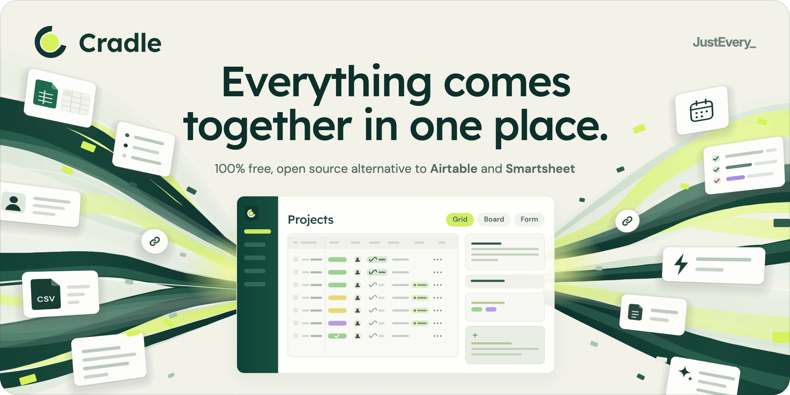
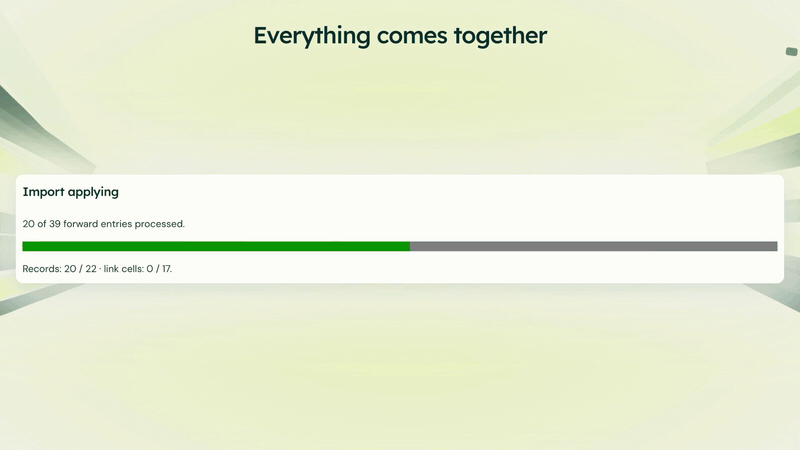
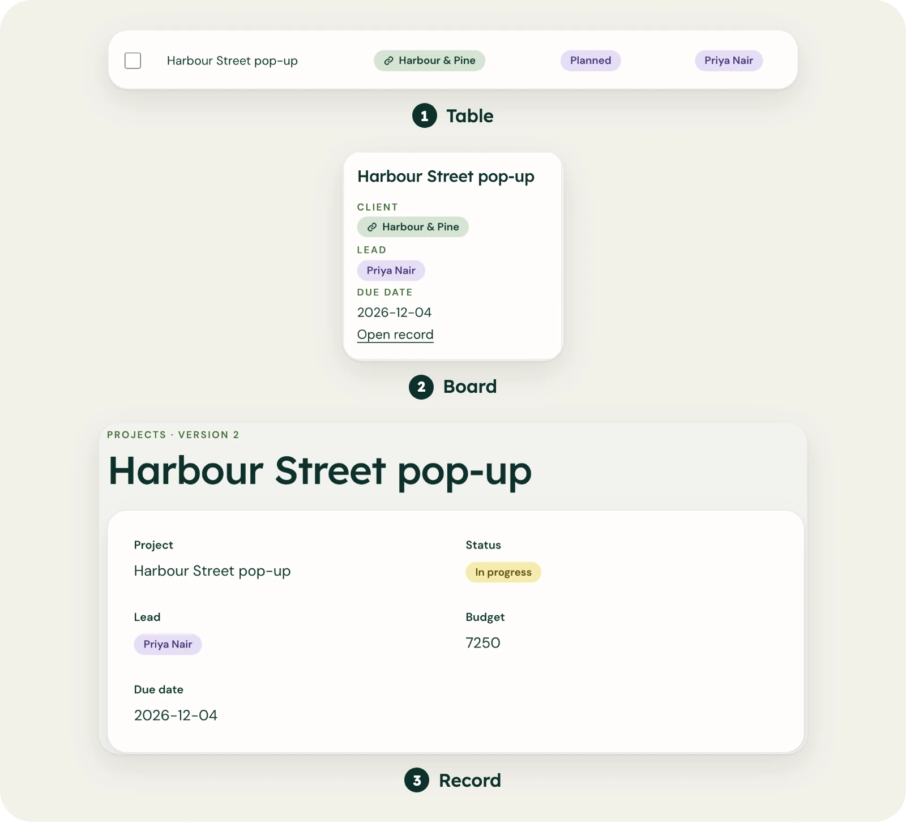
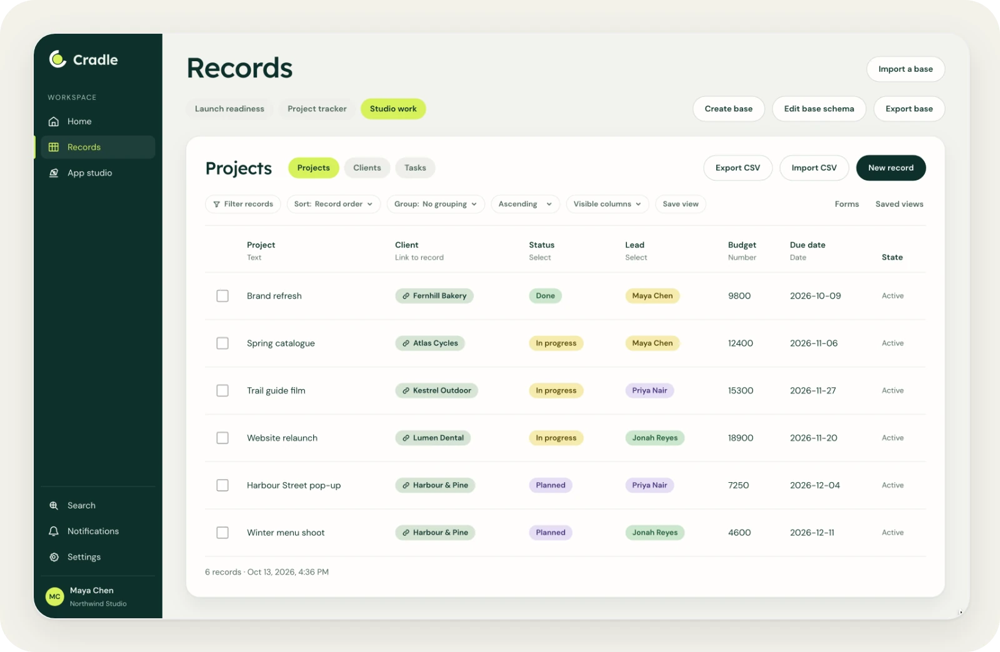
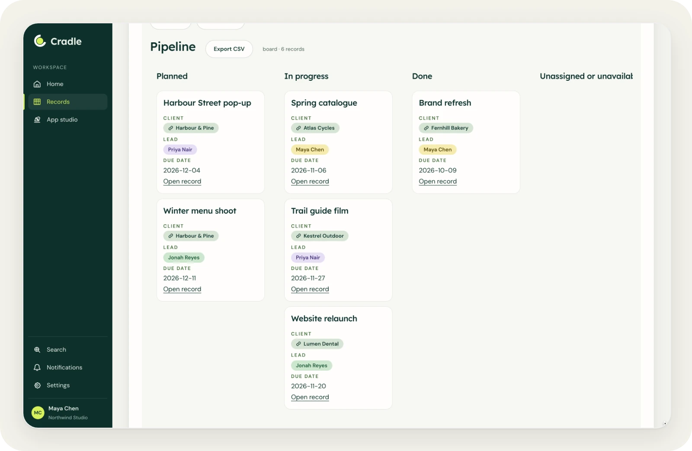
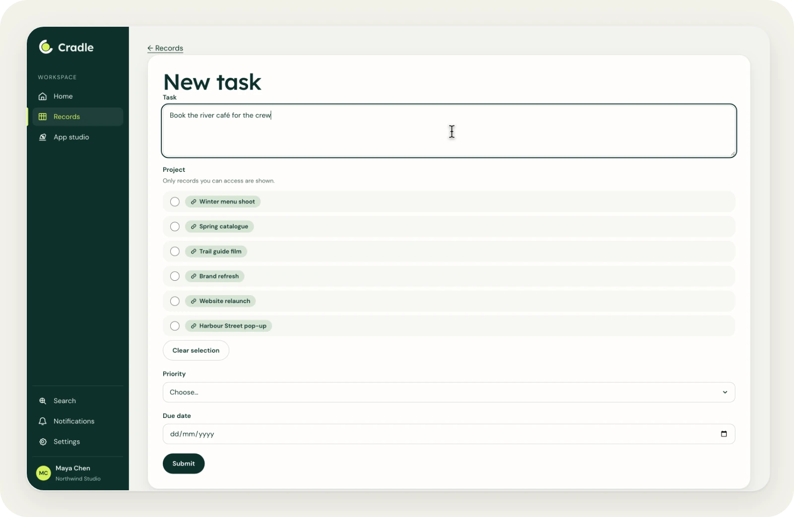

<p align="center">
  <a href="https://run-cradle.com">
    <picture>
      <source media="(prefers-color-scheme: dark)" srcset=".github/assets/banner-dark.webp">
      <source media="(prefers-color-scheme: light)" srcset=".github/assets/banner-light.webp">
      
    </picture>
  </a>
</p>

<p align="center"><a href="https://run-cradle.com">run-cradle.com</a> · <a href="https://justevery.com">Part of Just Every</a> · <a href="LICENSE">MIT licensed</a></p>

<p align="center">
  <a href="https://justevery.com/#vol-cradle"></a>
</p>
<p align="center"><a href="https://justevery.com/#vol-cradle"><b>Watch the full demo</b></a> · 55 seconds</p>

<p align="center">
  
</p>

<p align="center">
  <br>
  <sub>Records with linked tables, typed fields, filters and saved views.</sub>
</p>

<p align="center">
  <br>
  <sub>The same records as a board.</sub>
</p>

<p align="center">
  <br>
  <sub>And as a form anyone can fill in.</sub>
</p>

# Cradle

Cradle is a self-hosted records workspace with manual tables, linked records,
imports and exports, Launch planning, repair workflows, automations and an
owner-controlled editor. Public source: [just-every/run-cradle](https://github.com/just-every/run-cradle).

## Run it on your computer

Install the `rer` command once. It needs Node 22 or later; Cradle is tested with Node **22.20.0**.
Cradle pins rer **0.2.5**, which provisions pnpm **10.12.4** automatically;
you do not need to install pnpm first.

```sh
npx -y @runeditrun/rer@0.2.5 cli install
```

`curl -fsSL https://runeditrun.com/install.sh | sh` installs the same command
without npm. Then clone Cradle and start it:

```sh
git clone https://github.com/just-every/run-cradle.git cradle
cd cradle && rer dev
```

The first `rer dev` installs the pinned frozen dependencies, sets up a local owner
(`owner@cradle.test`), applies the migrations, starts the app and prints
`RER_READY` with its local URL, `RER_SIGNED_IN` and `RER_OPEN`. Open the `RER_OPEN`
URL on this computer: it carries this checkout's dev key in its fragment (treat it
as a credential), and the browser lands signed in as the owner. `rer dev --stop`
stops the app; the next `rer dev` keeps your data and owner.

To choose your own owner details instead, run setup before the first `rer dev`
with a private `answers.json` file (mode 0600), for example:

```json
{"OWNER_EMAIL":"owner@example.com","OWNER_NAME":"Owner","WORKSPACE_NAME":"My records","WORKSPACE_TIMEZONE":"Australia/Brisbane","WORKSPACE_CURRENCY":"AUD"}
```

```sh
rer setup --answers answers.json --non-interactive
rer dev
```

Setup prepares the real owner, migrations and private settings and exits with no
app running. A second setup reuses the saved answers, owner and exact private
bytes. A dev badge switches between the owner, signed out and the personas
`admin@dev.localhost` and `member@dev.localhost`; `rer dev --as PERSONA` starts as
one of them or `signed-out`. `rer dev --login` turns dev identity off and prints
`RER_SIGN_IN` for the ordinary local outbox: open it, choose the newest sign-in
message, follow its link and confirm. No email is sent locally. Keys minted in a
dev session work only with this checkout's dev key and never travel in an export.
Finish your first-run details at `/setup`; other app routes take you there until
completed. Later `/setup` opens the app. Settings remain editable.
Dev serves source with HMR. `rer preview` serves a fixed production build using
the same data. Choose a loopback port with `--port`; an occupied port fails.
`rer install` (or `pnpm install --frozen-lockfile`) installs the pinned
dependencies on their own; there is no install lifecycle hook.

Stop the app and verify:

```sh
rer dev --stop
PLAYWRIGHT_SKIP_BROWSER_GC=1 pnpm exec playwright install chromium
rer verify
```

Verification checks product types, real Worker/D1 flows, browsers, the command
contract, Base copies, the recursive portable onboarding suite and DB/FILES
movement. The optional `pnpm verify:authoring` also needs the isolated Docker
runner described in [authoring](authoring/README.md). It is separate from ordinary
installation. No provider credentials are needed for local use.

## Reset and move data

Stop dev/preview first. Keep the archive outside the reset inventory:

```sh
rer export --output exports/workspace.rer
rer reset --yes
rer import --input exports/workspace.rer --yes
rer setup --answers answers.json --non-interactive
rer dev
```

Import requires an empty destination and explicit confirmation. DB business
cells, including recomputed generated columns, and FILES bytes/metadata transfer.
Credentials, sessions, outbox and private settings do not. Imported definitions
and effects are held or disabled until separately approved. See
[installation archives](docs/installation-archives.md) for the exact policy.
Reset removes only inventoried local data, settings, owner, outbox and drafts;
source, dependencies, exports and deployment receipts survive.

## Build and host

```sh
rer build
rer deploy --dry-run
```

Dry-run validates the real owner-account artifact and makes no provider calls.
An authorized deployment uses `rer deploy --environment production`,
with the declared Cloudflare account, hosted email and private inputs. Provisioning,
immutable migrations, Worker/assets upload and health use Base deploy-kit.
After the healthy upload, rer automatically claims the designated owner and
removes the one-time setup token. A repeat deploy keeps the existing owner;
SETUP_TOKEN is not required after its recorded retirement.
Provider configuration is described in [installation](docs/installation.md).
A push to public main redeploys the marketing site; it does not deploy your app.

To update your installation, preserve owner customisations and merge the source
update, then run `rer install`, `rer verify`, and (when authorized)
`rer deploy --environment production`. To remove that hosted installation and
its data, use `rer deploy --environment production --remove --yes`. Rer uses
its deployment record and checks that the resources it created are gone.

For a local source export, run
`rer release --repo . --output ../cradle-export --clean-history`.
Release never pushes or deploys. Use `describe` for commands and flags, `doctor`
for local prerequisites, and `check --profile first-party` for the read-only
contract check before dependencies or configuration exist.

[CONTRACT.md](CONTRACT.md) records product guarantees; [BASELINE.md](BASELINE.md)
records security and operational requirements. [HANDOVER.md](HANDOVER.md) states
verification boundaries. Hosted management, live provider delivery and owner
account commissioning require their own actual installation proof.
